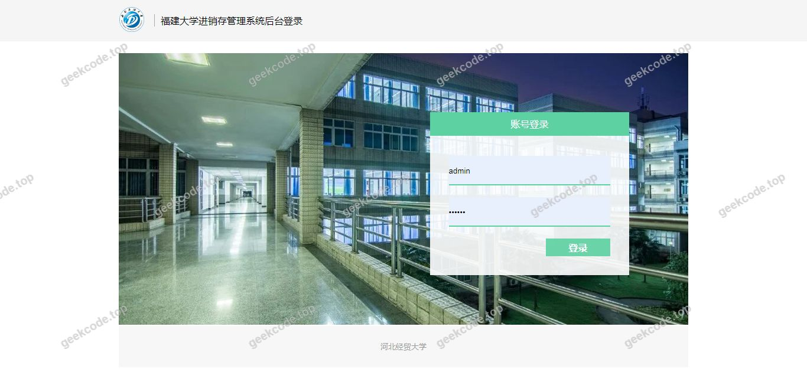
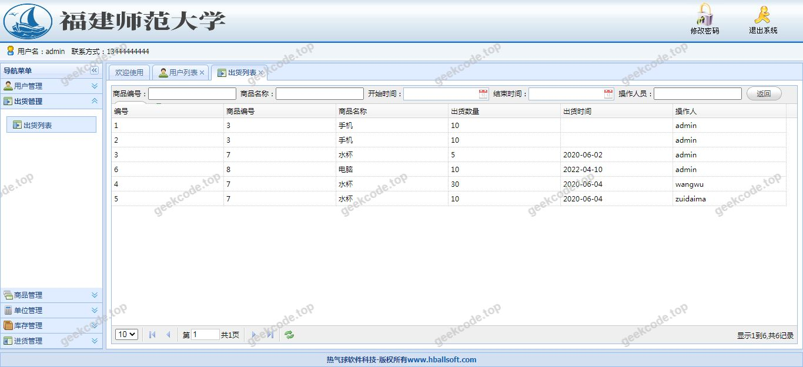
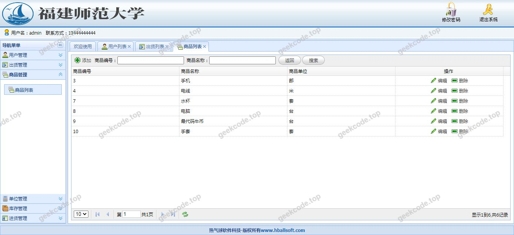
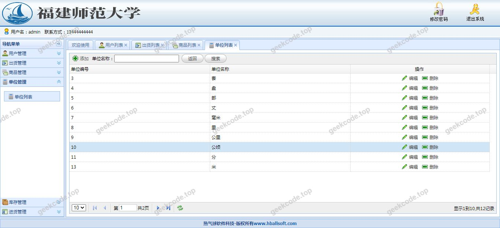
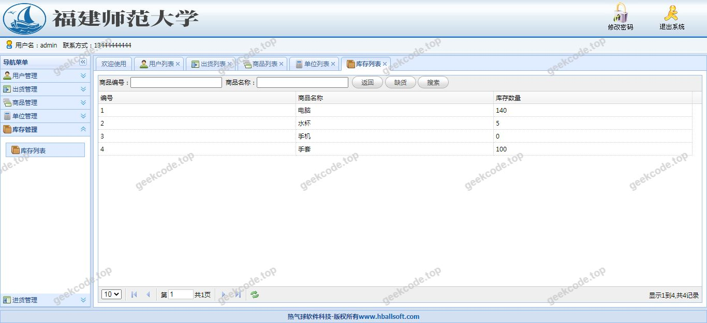
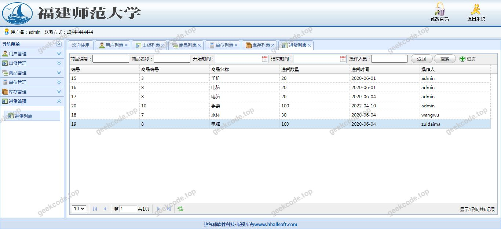

# java精品项目-基于SSM+EasyUI的进销存后台管理系统【毕业设计】

> 🎓 **计算机毕业设计 · java精品项目-基于SSM+EasyUI的进销存后台管理系统【毕业设计】**
>
> 本仓库只放**项目介绍 + 运行截图**（截图是站点带水印的原图，存在仓库 `images/` 里）。
>
> 👉 **完整可运行源码 / 数据库脚本 / 部署文档：[点我获取](https://geekcode.top/archives/java%E7%B2%BE%E5%93%81%E9%A1%B9%E7%9B%AE-%E5%9F%BA%E4%BA%8ESSM-EasyUI%E7%9A%84%E8%BF%9B%E9%94%80%E5%AD%98%E5%90%8E%E5%8F%B0%E7%AE%A1%E7%90%86%E7%B3%BB%E7%BB%9F%E3%80%90%E6%AF%95%E4%B8%9A%E8%AE%BE%E8%AE%A1%E3%80%91?utm_source=github)**
>
> 💬 咨询微信：**ir9372**　|　🌐 更多项目：[极客代码 geekcode.top](https://geekcode.top/?utm_source=github)
>
> 📌 项目详情页：<https://geekcode.top/archives/java%E7%B2%BE%E5%93%81%E9%A1%B9%E7%9B%AE-%E5%9F%BA%E4%BA%8ESSM-EasyUI%E7%9A%84%E8%BF%9B%E9%94%80%E5%AD%98%E5%90%8E%E5%8F%B0%E7%AE%A1%E7%90%86%E7%B3%BB%E7%BB%9F%E3%80%90%E6%AF%95%E4%B8%9A%E8%AE%BE%E8%AE%A1%E3%80%91?utm_source=github>

<table><td width="230" align="center"> <b>扫码加微信 ir9372</b></td><td valign="middle">📦 源码 = 项目介绍 + 全部运行截图 + 数据库 + 部署文档 👉 点上方任意截图，直接跳到 <b>极客代码 geekcode.top</b> 详情页</td></table>

---

<h1>java精品项目-基于SSM+EasyUI的进销存后台管理系统【毕业设计】</h1>
<h2>项目概述</h2>

本项目为“java精品项目-基于SSM+EasyUI的进销存后台管理系统”，旨在构建一套轻量级、模块化的企业库存与销售管理解决方案。系统核心功能涵盖商品入库、出库、库存查询及销售记录管理等进销存关键环节，适用于中小型商贸企业的日常业务数据化管理需求。技术架构采用经典的 Java Web 开发模式，后端基于 Spring MVC 与 MyBatis（SSM）框架实现业务逻辑与数据持久化，前端集成 EasyUI 组件库以提供标准化的后台管理界面交互体验。该系统专注于后台管理流程，未涉及前台用户端展示，主要服务于企业内部管理员及操作人员，通过网页浏览器即可完成对商品流转全生命周期的监控与管理，有效降低人工统计错误率，提升库存周转效率。

<h2>技术架构</h2>

本系统采用分层架构设计，严格遵循 MVC（Model-View-Controller）设计模式，确保代码的可维护性与扩展性。

<strong>1. 后端架构</strong>

<ul>
<li><strong>控制层 (Controller)</strong>：使用 <code>spring-webmvc</code> 处理 HTTP 请求，负责接收前端参数、调用业务服务并返回视图或 JSON 数据。</li>
<li><strong>业务层 (Service)</strong>：由 <code>spring-context</code> 和 <code>spring-tx</code> 提供支持，实现事务管理与业务逻辑封装，确保数据操作的一致性。</li>
<li><strong>持久层 (DAO/Mapper)</strong>：采用 <code>mybatis</code> 作为 ORM 框架，配合 <code>mybatis-spring</code> 进行整合。通过 XML 映射文件或注解定义 SQL 语句，实现对 MySQL 数据库的高效访问。</li>
<li><strong>依赖注入</strong>：利用 Spring IoC 容器管理 Bean 的生命周期，降低组件间的耦合度。</li>
</ul>

<strong>2. 前端架构</strong>

<ul>
<li><strong>页面渲染</strong>：基于 JSP (JavaServer Pages) 技术生成动态 HTML 页面，结合 <code>jstl</code> (JSTL) 标签库简化页面逻辑判断与循环遍历。</li>
<li><strong>UI 框架</strong>：引入 EasyUI 插件，提供表格、表单、对话框等常用后台管理组件，统一视觉风格并增强交互体验。</li>
<li><strong>Servlet API</strong>：底层依托 <code>servlet-api</code> 标准接口运行于 Servlet 容器中。</li>
</ul>

<strong>3. 数据库设计要点</strong>

<ul>
<li><strong>存储引擎</strong>：使用 MySQL 关系型数据库，通过 <code>mysql-connector-java</code> 驱动建立连接。</li>
<li><strong>数据模型</strong>：虽具体表结构未在上下文中详细列出，但依据进销存业务逻辑，核心实体应包含商品信息、库存数量、出入库单据、供应商信息及操作员账号等，并通过外键约束保证数据完整性。</li>
</ul>
<h2>功能模块</h2>

根据项目定位“后台管理系统”及截图显示的系统运行界面，主要功能模块集中在后台管理侧。由于上下文明确标注“是否有前台: 否”、“是否有后台路由: (无)”以及“个人中心菜单: (无)”，以下功能描述仅基于项目名称“进销存”及通用后台管理逻辑推导出的核心业务域，不涉及具体的导航菜单项罗列。

<h3>后台管理端</h3>
<ol>
<li><strong>基础信息管理模块</strong></li>
</ol>
<ul>
<li>负责商品档案的建立与维护，包括商品名称、规格、单位、分类、初始库存及价格信息的录入与修改。</li>
<li>管理供应商与客户基础资料，为采购与销售环节提供对象支持。</li>
</ul>
<ol start="2">
<li><strong>库存管理模块</strong></li>
</ol>
<ul>
<li><strong>入库管理</strong>：处理采购入库单，增加指定商品的库存数量，记录入库时间、经手人及备注信息。</li>
<li><strong>出库管理</strong>：处理销售出库或调拨出库单，扣减库存数量，关联对应的销售订单或领用申请。</li>
<li><strong>库存盘点</strong>：提供实时库存查询功能，支持按商品、分类查看当前剩余数量，辅助进行实物盘点核对。</li>
</ul>
<ol start="3">
<li><strong>进销存报表模块</strong></li>
</ol>
<ul>
<li>汇总一定时间段内的进货总量、销售总量及库存变动情况。</li>
<li>生成简单的流水记录，便于管理员追溯历史操作日志。</li>
</ul>

<em>(注：根据现有信息无法确定更细粒度的子功能菜单，如权限分配、系统设置等具体界面细节)</em>

<h2>用户角色与权限</h2>

鉴于项目类型为“后台管理系统”且未提及多租户或复杂的前台用户体系，本系统主要面向企业内部管理人员。根据常规 SSM 架构项目的权限设计惯例，结合“进销存”业务场景，角色划分如下：

<table>
<thead>
<tr>
<th align="left">角色名称</th>
<th align="left">功能权限描述</th>
</tr>
</thead>
<tbody><tr>
<td align="left"><strong>超级管理员</strong></td>
<td align="left">拥有系统最高权限。可访问所有功能模块，包括基础数据配置、库存单据审核、查看所有报表、管理其他操作员账号及重置密码。</td>
</tr>
<tr>
<td align="left"><strong>仓库管理员</strong></td>
<td align="left">专注于库存操作。权限范围限于“基础信息管理”中的商品维护、“库存管理”中的入库登记、出库执行及库存查询。无权查看财务敏感的销售金额明细或修改系统配置。</td>
</tr>
<tr>
<td align="left"><strong>普通操作员</strong></td>
<td align="left">受限权限用户。仅可进行日常的单据录入工作（如新建入库/出库草稿），需提交给上级审核后方可生效。只能查询与自己操作相关的历史记录，无法删除或修改已审核的单据。</td>
</tr>
</tbody></table>

<em>(注：具体角色定义取决于实际数据库中的用户表设计，上述为基于业务逻辑的标准推断)</em>

<h2>项目特色与创新点</h2>
<ol>
<li>
<strong>经典稳定的技术组合</strong>
   采用 SSM (Spring + Spring MVC + MyBatis) 这一业界成熟的技术栈，相较于新兴框架，其文档丰富、社区支持强大，非常适合毕业设计阶段的学习与演示，能够清晰展示 Java Web 的分层架构思想。

</li>
<li>
<strong>高效的前端交互体验</strong>
   集成 EasyUI 组件库，避免了原生 JavaScript 复杂的 DOM 操作和 CSS 样式编写。通过声明式的方式快速构建出具有专业外观的数据表格、树形菜单和模态窗口，显著提升了后台管理界面的开发效率和用户体验一致性。

</li>
<li>
<strong>轻量级部署与维护</strong>
   项目基于传统的 WAR 包部署模式，不依赖 Node.js 等前端构建工具链，环境配置简单。MyBatis 灵活地分离了 SQL 语句与 Java 代码，使得针对进销存这种查询条件多变、报表统计复杂的业务场景，能够方便地进行 SQL 优化和维护。

</li>
<li>
<strong>聚焦核心业务闭环</strong>
   剔除了非必要的 C 端前台展示，集中资源打磨 B 端后台的业务逻辑完整性。从商品建档到出入库流转，形成了完整的数据闭环，体现了软件工程中对“核心业务流程”优先保障的设计原则。

</li>
</ol>
<h2>部署环境</h2>

为确保系统正常运行，需准备以下软硬件环境：

<ul>
<li><strong>操作系统</strong>：Windows 7/10/11, Linux (CentOS/Ubuntu), macOS 均可。</li>
<li><strong>Java 环境</strong>：JDK 1.8 或以上版本（推荐 JDK 1.8，因 SSM 旧版本常与之兼容）。</li>
<li><strong>Web 服务器</strong>：Apache Tomcat 8.5 或 9.0（需支持 Servlet 3.1+ 规范）。</li>
<li><strong>数据库</strong>：MySQL 5.7 或 MySQL 8.0。需安装 <code>mysql-connector-java</code> 对应版本的 JDBC 驱动。</li>
<li><strong>开发工具</strong>：IntelliJ IDEA 或 Eclipse (需安装 Maven 插件)。</li>
<li><strong>浏览器</strong>：Chrome, Firefox, Edge 等现代主流浏览器（用于访问 JSP 生成的页面）。</li>
</ul>

<strong>启动步骤简述：</strong>

<ol>
<li>导入项目源码至 IDE。</li>
<li>配置 <code>application.properties</code> 或 <code>jdbc.properties</code> 中的数据库连接 URL、用户名和密码。</li>
<li>在 MySQL 中创建数据库并执行初始化脚本（如有）。</li>
<li>配置 Tomcat 服务器路径，将项目发布到 Tomcat。</li>
<li>启动 Tomcat，通过浏览器访问 <code>http://localhost:8080/[项目名]/</code> 进入登录界面。</li>
</ol>
<h2>五、技术特性</h2>
<ul>
<li>服务端模板渲染（JSP）</li>
</ul>
<h2>六、功能模块截图</h2>
<h3>前台用户端</h3>
<h4>系统运行界面1</h4>

<h4>系统运行界面2</h4>

<h4>系统运行界面3</h4>

<h4>系统运行界面4</h4>

<h4>系统运行界面5</h4>

<h4>系统运行界面6</h4>

---

## 获取完整源码

| 项目 | 说明 |
| --- | --- |
| 项目名 | java精品项目-基于SSM+EasyUI的进销存后台管理系统【毕业设计】 |
| 运行截图 | 本文 6 张（站点带水印原图，仓库 `images/` 目录） |
| 完整源码 | [https://geekcode.top/archives/java%E7%B2%BE%E5%93%81%E9%A1%B9%E7%9B%AE-%E5%9F%BA%E4%BA%8ESSM-EasyUI%E7%9A%84%E8%BF%9B%E9%94%80%E5%AD%98%E5%90%8E%E5%8F%B0%E7%AE%A1%E7%90%86%E7%B3%BB%E7%BB%9F%E3%80%90%E6%AF%95%E4%B8%9A%E8%AE%BE%E8%AE%A1%E3%80%91?utm_source=github](https://geekcode.top/archives/java%E7%B2%BE%E5%93%81%E9%A1%B9%E7%9B%AE-%E5%9F%BA%E4%BA%8ESSM-EasyUI%E7%9A%84%E8%BF%9B%E9%94%80%E5%AD%98%E5%90%8E%E5%8F%B0%E7%AE%A1%E7%90%86%E7%B3%BB%E7%BB%9F%E3%80%90%E6%AF%95%E4%B8%9A%E8%AE%BE%E8%AE%A1%E3%80%91?utm_source=github) |
| 咨询微信 | **ir9372**（备注：jingpin-yuanma） |
| 更多项目 | [极客代码 geekcode.top](https://geekcode.top/?utm_source=github) |

> 需要源码、部署、改配置、跑不起来等问题，加微信 ir9372 沟通，说明项目名即可。
